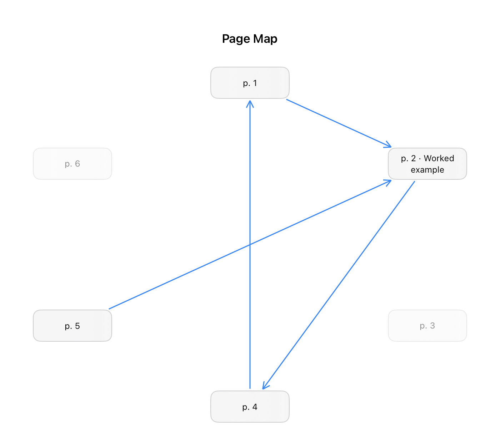
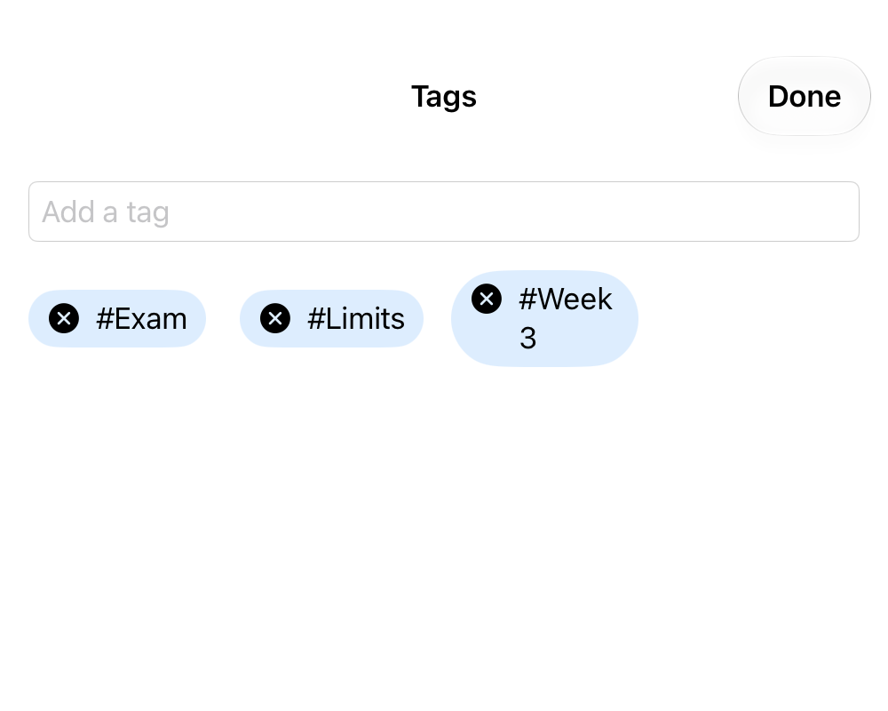
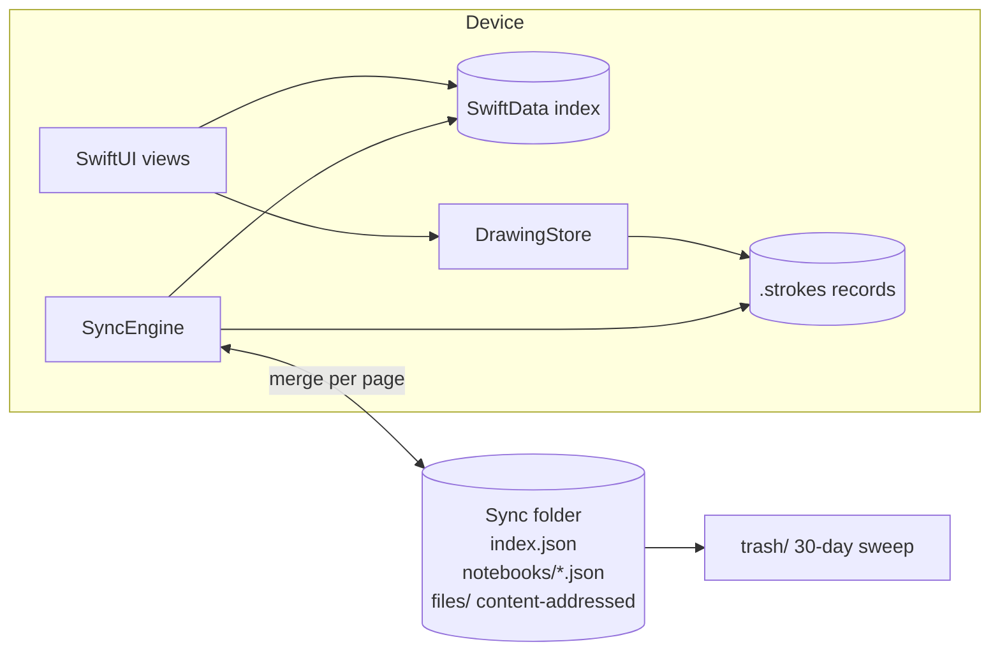

<p align="center">
  
</p>

<h1 align="center">Linework</h1>

<p align="center"><b>Handwritten notes you can connect.</b><br>
A native iPad and Mac notebook where every page, and every scribble on it, can become a node in a graph.</p>

<p align="center">
  Swift 6 · SwiftUI · PencilKit · SwiftData · Vision · PDFKit · no third-party dependencies
</p>

---

I built this because GoodNotes is very good and also closed. My notes lived in a format I couldn't read without it, on a sync system I didn't control. I wanted out.

Linework is the answer to "what if a notes app were built like a database engineer would build it, and then made pleasant to use". The ink is stored in an open stroke format. Sync is a folder you pick. And the long-term idea is that notes aren't a filing cabinet. They're a graph you can draw on.

<p align="center">
  
  
</p>

## What it does

**Write.** Five ink types plus a highlighter, both erasers, a fill tool and a lasso that moves, resizes and rotates. The toolbar is custom and drives PencilKit directly, so the Pencil keeps PencilKit's low-latency path. Hold at the end of a stroke and a rough line, arrow, circle or polygon snaps clean. Lines keep exactly the ends you drew.

**Connect.** Link any page or lassoed region to another page, even across notebooks. Every page shows what links to it. Type `[[` in a text box to mention a page. Tag pages, and open the Page Map to see a notebook as a graph you can rearrange.

**Find.** Search covers typed text, PDF text layers and your own handwriting, recognised on device. Handwriting is indexed in the background, so a search is instant. Tap a result and the match pops out in a magnifier on the page.

**Study.** An optional AI study helper summarises a page, explains it, quizzes you on it, or reads it aloud. It runs on your own Featherless and ElevenLabs keys, is off by default, and sends nothing unless you ask. It can even write its answer on the page in your handwriting, from an alphabet you write once.

**Keep.** Export a page, a notebook, Markdown, or the whole library. A daily backup goes to any folder. Deleted pages sit in a trash for 30 days. Everything works offline with no account.

## The engineering

If you're here to read code, these are the decisions that took the most thought.

### Ink is not in the database

A page of ink can run to megabytes. If it lives in a synced database, every autosave ships the whole blob.

So `Page` holds only a file name. The file is the record, in a neutral stroke format (`StrokeCodec`) where every stroke has an ID that never changes. Links, nodes and the coming stroke timeline all point at those IDs. The `PKDrawing` next to it is just a cache, rebuilt whenever its hash doesn't match. `DrawingStore` is the only code that reads or writes either one, and every write is atomic.

### Sync is a folder, not CloudKit

You pick a folder in iCloud Drive, Dropbox or anything the Files app can see. That folder is the source of truth. The SwiftData store is only an index, and Settings can throw it away and rebuild it from the folder.



`SyncEngine` merges per page on `Page.modifiedAt` and never rebuilds a page tree. When two devices edit the same page, the loser's ink goes to `trash/` instead of being thrown away. Nothing in the app deletes a payload outright: it moves to the trash, and only a 30-day sweep empties it. A two-library test harness (`SyncTests`) pins all of this down.

### Nothing heavy runs while you draw

The project builds with `SWIFT_DEFAULT_ACTOR_ISOLATION = MainActor`. That once quietly moved the entire sync engine onto the main thread. Now saving, sync, OCR, indexing and off-screen rendering all run off it. The off-screen renders share one serial queue, because PencilKit deadlocks when Swift's thread pool fills up with them. That bug only ever showed up on a real iPad, found with a spindump.

### Handwriting search you only pay for once

`HandwritingRecognizer` renders the ink back to an image at 2x, composites it on white (Vision sees nothing on transparent ink) and runs `VNRecognizeTextRequest`. That's the slowest thing the app does. So it runs once per edit in the background, the result is cached on the page and synced, and a page whose ink hasn't changed is never read twice.

### The graph grows out of one model

There's no separate graph database. A `Link` has a kind (plain link, mention, node, transclusion), a destination and optional stroke IDs. A node is a named region of ink, held by the IDs of its strokes, so it follows the ink when you move it and greys out if you erase it.

## Running it

Open `MystNotes.xcodeproj` in Xcode and run. It needs iPadOS 26.5 or later, and the Mac build uses Catalyst. A free Apple developer account is enough to sign it. The Xcode target is still called `MystNotes`, the app's working name.

An Apple Pencil helps. On an iPad the finger pans and the Pencil draws. On a Mac the mouse draws.

Run the tests on the iPad simulator with `.claude/hooks/run-tests.sh`. It boots the simulator and runs a clean build.

## Project layout

```
MystNotes/
  MystNotesModels.swift       SwiftData models (the index, not the source of truth)
  DrawingStore.swift          the only reader and writer of ink files
  StrokeCodec.swift           the neutral stroke format and its stroke IDs
  SyncEngine.swift            folder sync, merged per page
  TrashRetention.swift        the 30-day sweep, the only delete of a payload
  Links.swift                 every change to a link or node goes through here
  NotebookGraphView.swift     the Page Map
  PencilCanvasView.swift      PKCanvasView wrapped for SwiftUI
  DrawingToolbarView.swift    the custom toolbar and pen picker
  ShapeRecognizer.swift       hold-to-snap shape cleanup
  HandwritingRecognizer.swift Vision OCR over the ink
  SearchIndex.swift           typed text, handwriting and PDF text
  AIClient.swift              the opt-in study helper
  DesignSystem.swift          spacing, type, colour and shared components
  MystNotesDetailView*.swift  the page editor, split by concern
MystNotesTests/               sync harness, durability, codec and performance suites
Docs/                         project plan, format spec, competitive gaps, brand
```

## What it deliberately doesn't do

**No native AppKit build.** PencilKit needs UIKit, so the Mac app runs on Catalyst.

**No real-time collaboration.** Sync keeps one person's devices in step. Shared notebooks need a server and real conflict handling for ink. That's its own project.

**No paywall.** It's free.

## Status

In daily use on my iPad. Correctness (M0) and GoodNotes parity (M1) are built. The graph (M2) is in progress. Live status is in [`PLAN.md`](PLAN.md), and an honest list of where GoodNotes and OneNote are still ahead is in [`Docs/COMPETITIVE_GAPS.md`](Docs/COMPETITIVE_GAPS.md).
